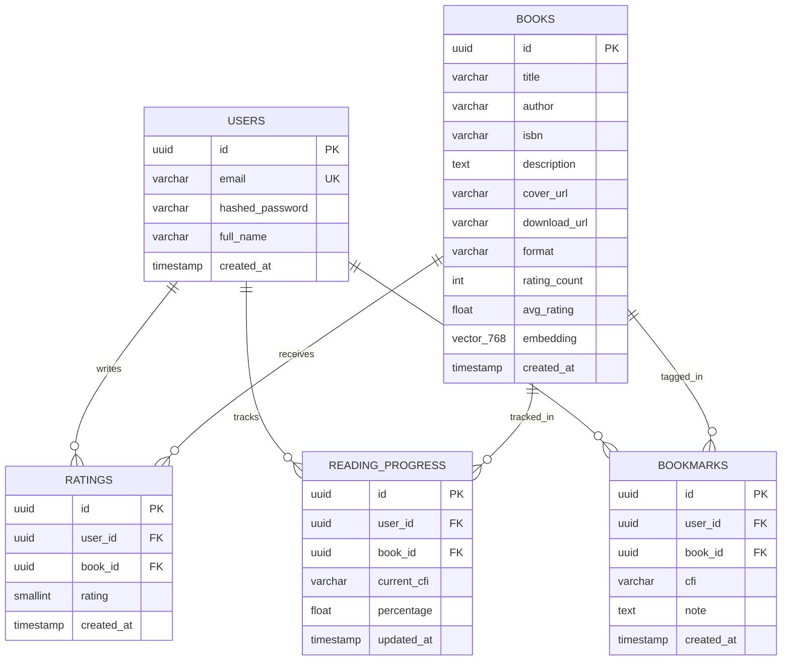

# 🏛️ PagePulse AI — System Architecture & Technical Design Document

> **File:** `ARCHITECTURE.md`  
> **Status:** Active Blueprint for Developers & Reviewers  
> **Target:** Onboarding, System Understanding, Architectural Decision Records (ADRs)  

---

## 1. High-Level Architecture Topology

PagePulse AI is built as a **cloud-native, decoupled distributed system** comprising a cross-platform mobile client, an asynchronous Python API microservice, a relational database equipped with vector search extensions, an in-memory cache, and external digital book & AI provider integrations.

```
┌────────────────────────────────────────────────────────────────────────┐
│                        CLIENT LAYER (Mobile & Web)                     │
│   Expo React Native (TypeScript) - iOS / Android / Web                 │
│   ├── UI Components (Design System #E285C3)                            │
│   ├── Offline EPUB / PDF Reader (epubjs-rn / react-native-pdf)         │
│   ├── Global State (Zustand) & Cache (TanStack Query)                  │
│   └── Offline Storage (expo-file-system / AsyncStorage)                │
└───────────────────────────────────┬────────────────────────────────────┘
                                    │ HTTPS (TLS 1.3) / WebSocket
                                    ▼
┌────────────────────────────────────────────────────────────────────────┐
│                         API GATEWAY & FASTAPI CORE                     │
│   FastAPI (Python 3.11+, ASGI / Uvicorn)                               │
│   ├── Authentication & RBAC (OAuth2 + JWT + Bcrypt)                    │
│   ├── Rate Limiting & Security Headers (SlowAPI, CORS)                 │
│   ├── Dependency Injection & Validation (Pydantic v2)                  │
│   └── Routing Layer (v1): /auth, /books, /recommend, /library, /ai    │
└──────────────┬────────────────────┬────────────────────┬───────────────┘
               │                    │                    │
               ▼                    ▼                    ▼
┌─────────────────────────┐ ┌───────────────┐ ┌──────────────────────────┐
│   DATABASE LAYER        │ │  CACHE LAYER  │ │   EXTERNAL INTEGRATIONS  │
│  PostgreSQL 16          │ │  Redis 7.2    │ │  1. Gutendex API (EPUB)  │
│  ├── Relational Tables  │ │  ├── Tokens   │ │  2. Open Library Covers  │
│  ├── pgvector Extension │ │  ├── Ratelimit│ │  3. Google Gemini 2.5 API│
│  └── HNSW Cosine Index  │ │  └── Rec Cache│ │  4. Standard Ebooks      │
└─────────────────────────┘ └───────────────┘ └──────────────────────────┘
```

---

## 2. Frontend Architecture (Expo React Native)

### 2.1. Structural Principles
- **Framework**: Expo SDK 51+ with React Native and strict **TypeScript**.
- **Routing**: `expo-router` using file-based routing architecture.
- **State Management**:
  - **Server State**: `TanStack Query (React Query)` for data fetching, caching, deduplication, and optimistic updates.
  - **Client State**: `Zustand` for lightweight local state (user preferences, active theme, audio/reading speed).
  - **Persistent Storage**: `expo-file-system` for downloaded `.epub` / `.pdf` book files; `@react-native-async-storage/async-storage` for tokens and reading bookmarks.

### 2.2. Directory Structure (`apps/mobile`)
```text
apps/mobile/
├── app/                              # File-based navigation
│   ├── (auth)/                       # Login, Register, Forgot Password
│   ├── (tabs)/                       # Bottom Tab Navigation
│   │   ├── index.tsx                 # Home Screen (Featured, Recent, Popular)
│   │   ├── explore.tsx               # Semantic Mood Search & Browse
│   │   ├── library.tsx               # My Shelf (Offline books & progress)
│   │   └── profile.tsx               # Reading stats & preferences
│   ├── book/
│   │   └── [id].tsx                  # Book Details & Actions
│   ├── reader/
│   │   └── [id].tsx                  # Full-screen In-App Reading Engine
│   └── _layout.tsx                   # Root Provider & Global Error Boundary
├── src/
│   ├── components/                   # Reusable UI widgets (BookCard, Sheet, ReaderUI)
│   ├── constants/theme.ts            # Brand tokens (#E285C3, #818CF8, etc.)
│   ├── hooks/                        # Custom hooks (useReader, useAuth, useOfflineBook)
│   ├── services/api.ts               # Axios instance with auto JWT refresh interceptors
│   └── store/                        # Zustand stores (authStore, libraryStore)
```

### 2.3. Digital In-App Reader Subsystem
1. When user taps "Read" or "Download":
   - The app verifies if the `.epub` file exists locally in `FileSystem.documentDirectory`.
   - If not present, it streams the book from `GET /api/v1/books/{id}/download` and saves it locally.
2. The reader renders via an embedded clean DOM bridge (`epubjs-rn`) inside a native WebView.
3. User interactions (page changes, highlighted passages, notes) emit CFI (Canonical Fragment Identifier) updates that are saved locally and synced asynchronously to the backend.

---

## 3. Backend Architecture (Python FastAPI)

### 3.1. Layered Clean Architecture
To prevent spaghetti code, the backend enforces a strict **Domain-Driven, Layered Architecture**:

```
[ Request ] ──► [ Router / API ] ──► [ Service Layer ] ──► [ Repository Layer ] ──► [ Database ]
                      │                      │                        │
                      ▼                      ▼                        ▼
                Pydantic DTOs         Business Rules            SQLAlchemy 2.0
```

1. **API / Controller Layer** (`app/api/v1/`):
   - Handles HTTP routing, header validation, request deserialization, and HTTP response formatting.
   - Zero database queries or raw business logic permitted here.
2. **Service Layer** (`app/services/`):
   - Encapsulates pure business logic (recommendation calculation, vector generation, Gutendex parsing).
3. **Data Access / Repository Layer** (`app/repositories/`):
   - Interacts with SQLAlchemy models, executes async transactions, and abstracts database queries.
4. **Schemas Layer** (`app/schemas/`):
   - Pydantic v2 schemas validating request inputs and defining OpenAPI responses.

### 3.2. Directory Structure (`apps/backend`)
```text
apps/backend/
├── app/
│   ├── api/v1/                       # Version 1 API routers
│   │   ├── auth.py                   # /api/v1/auth
│   │   ├── books.py                  # /api/v1/books
│   │   ├── recommend.py              # /api/v1/recommend
│   │   ├── library.py                # /api/v1/library
│   │   └── ai_agent.py               # /api/v1/ai
│   ├── core/                         # Core infrastructure
│   │   ├── config.py                 # Pydantic BaseSettings (.env loading)
│   │   ├── database.py               # Async SQLAlchemy engine & session factory
│   │   ├── security.py               # Password hashing (bcrypt) & JWT issuance
│   │   └── redis.py                  # Redis connection pool
│   ├── models/                       # SQLAlchemy 2.0 ORM entities
│   │   ├── user.py
│   │   ├── book.py
│   │   ├── rating.py
│   │   └── reading_progress.py
│   ├── schemas/                      # Pydantic v2 Request/Response models
│   ├── services/                     # Business logic & algorithms
│   │   ├── recommender_service.py    # Hybrid CF + Vector similarity
│   │   ├── embedding_service.py      # Dense vector generator
│   │   ├── gutenberg_service.py      # Book download & metadata ingest
│   │   └── ai_librarian_service.py   # Google Gemini 2.5 API integration
│   └── main.py                       # FastAPI ASGI entrypoint
├── alembic/                          # Database schema migration versions
├── requirements.txt
└── Dockerfile
```

---

## 4. Database Architecture & Schema Design

### 4.1. PostgreSQL 16 + `pgvector`
The database stores standard relational transactional data alongside high-dimensional vector embeddings within the same database engine, eliminating the overhead of managing a separate vector database.



### 4.2. Indexing Strategy
- **`books.embedding`**: Indexed with **HNSW (Hierarchical Navigable Small World)** using cosine distance:
  ```sql
  CREATE INDEX idx_books_embedding ON books 
  USING hnsw (embedding vector_cosine_ops) 
  WITH (m = 16, ef_construction = 64);
  ```
- **`books.title`, `books.author`**: Indexed with trigram `gin_trgm_ops` for fast fuzzy substring search.
- **`ratings(user_id, book_id)`**: Unique compound index to prevent duplicate ratings.

---

## 5. Recommendation Engine Architecture

### 5.1. The Hybrid Recommendation Pipeline
The legacy system relied entirely on a static offline cosine similarity matrix calculated over a pivot table of 706 books. 
The production architecture implements a **Hybrid 3-Tier Recommender**:

```
[ User Request ]
       │
       ├─► Scenario A: Natural Language / Mood Query ("Intriguing Victorian mystery")
       │   └──► Vector Search: Query ──► Gemini Embedding (768d) ──► pgvector HNSW Cosine Search
       │
       ├─► Scenario B: Book Detail Screen ("More like Pride and Prejudice")
       │   └──► Item-to-Item Similarity: Blend vector distance (synopsis/genre) with co-rating cosine score
       │
       └─► Scenario C: Personalized Feed ("Recommended for You")
           └──► Collaborative Filtering: Matrix Factorization over user reading history + vector affinity
```

---

## 6. Security & Authentication Architecture

1. **Password Security**: Passwords hashed using `bcrypt` with salt rounds = 12. No plaintext passwords stored anywhere.
2. **Stateless JWT Flow**:
   - Access Token: Short-lived (15 minutes), signed using `HS256` or `RS256`.
   - Refresh Token: Long-lived (7 days), stored encrypted in the database with rotation on every refresh request.
3. **CORS & Rate Limiting**:
   - Restricted CORS whitelist for Expo web and production domains.
   - Per-IP rate limiting powered by Redis (e.g., 60 requests/minute for standard APIs; 5 requests/minute for auth).

---

## 7. Recommended IDE Extensions & Tooling

To ensure developer productivity, code quality, and consistency across team members, the following extensions are standardized for the workspace:

### Backend (Python & FastAPI)
- **Python** (`ms-python.python`): IntelliSense, linting, code formatting.
- **Pylance** (`ms-python.vscode-pylance`): High-performance type checking.
- **Ruff** (`charliermarsh.ruff`): Blazing fast Python linter and formatter (replaces flake8, black, isort).
- **REST Client / Thunder Client**: In-IDE API testing.

### Frontend (React Native & Expo)
- **Expo Tools** (`expo.vscode-expo-tools`): Config debugging, autocomplete for `app.json`.
- **ESLint** (`dbaeumer.vscode-eslint`): Code quality and React hooks rules.
- **Prettier** (`esbenp.prettier-vscode`): Standardized TypeScript/JSX formatting.
- **Tailwind CSS IntelliSense** (`bradlc.vscode-tailwindcss`): If using NativeWind for styling.

### Database & DevOps
- **PostgreSQL** (`ckolkman.vscode-postgres`): Database exploration and SQL query execution.
- **Docker** (`ms-azuretools.vscode-docker`): Container management.
- **Markdown All in One** (`yzhang.markdown-all-in-one`): Specification documentation and preview.
