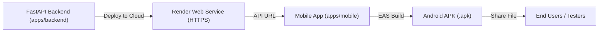

# 🚀 PagePulse AI — 3-Stage Production Deployment Guide

This guide walks you step-by-step through deploying your **FastAPI Backend to Render (Free)** and generating a **Standalone Android APK** for other users to install and test.

---

## 🗺️ Deployment Overview



---

## 📦 Stage 1: Deploy the FastAPI Backend to Render

[Render](https://render.com) provides a free tier with automatic HTTPS, continuous deployment from GitHub, and zero server maintenance.

### Method A: Blueprint (Recommended - 1 Click)
1. Push your repository to **GitHub**.
2. Go to your [Render Dashboard](https://dashboard.render.com).
3. Click **New +** &rarr; **Blueprint**.
4. Connect your `Book-Recommendation-System` repository.
5. Render will automatically detect [`render.yaml`](file:///e:/Book-Recommendation-System/render.yaml) and configure the build and environment variables.
6. Click **Apply**.

---

### Method B: Manual Web Service Setup
If you prefer configuring it manually on Render:
1. Go to [Render Dashboard](https://dashboard.render.com) &rarr; **New +** &rarr; **Web Service**.
2. Connect your GitHub repository.
3. Fill in the following settings:
   - **Name**: `pagepulse-backend`
   - **Root Directory**: `apps/backend`
   - **Runtime**: `Python 3`
   - **Region**: Any close to you (e.g., `Singapore` or `Frankfurt`)
   - **Branch**: `main`
   - **Build Command**:
     ```bash
     pip install --upgrade pip && pip install -r requirements.txt
     ```
   - **Start Command**:
     ```bash
     uvicorn app.main:app --host 0.0.0.0 --port $PORT
     ```
   - **Instance Type**: `Free`
4. Under **Environment Variables**, add:
   | Key | Value | Notes |
   | :--- | :--- | :--- |
   | `PYTHONPATH` | `.` | Ensures module resolution |
   | `PROJECT_NAME` | `PagePulse AI` | App name |
   | `API_V1_STR` | `/api/v1` | Base route prefix |
   | `JWT_SECRET_KEY` | *(Click "Generate")* | Random secure string |
   | `ACCESS_TOKEN_EXPIRE_MINUTES` | `1440` | 24 hour tokens |
   | `REFRESH_TOKEN_EXPIRE_DAYS` | `30` | 30 day refresh tokens |
   | `CORS_ORIGINS` | `["*"]` | Allows mobile connections |
   | `DATABASE_URL` | `sqlite+aiosqlite:///./pagepulse.db` | Local SQLite database |
5. Click **Deploy Web Service**.
6. Once deployed, Render will provide a public URL like:
   `https://pagepulse-backend-xyz.onrender.com`
7. Test it by opening:
   `https://pagepulse-backend-xyz.onrender.com/docs`

---

## 📱 Stage 2: Connect the Mobile App to the Live Backend

Once your backend is live on Render:

1. Open [`apps/mobile/.env`](file:///e:/Book-Recommendation-System/apps/mobile/.env).
2. Replace the local IP with your live Render URL:
   ```env
   EXPO_PUBLIC_API_URL=https://your-render-app-name.onrender.com/api/v1
   ```
3. Test the mobile app locally against the cloud backend:
   ```bash
   cd apps/mobile
   npx expo start
   ```

---

## 📲 Stage 3: Build the Android APK (For User Distribution)

We use Expo Application Services (EAS Build) configured in [`apps/mobile/eas.json`](file:///e:/Book-Recommendation-System/apps/mobile/eas.json) to generate a standalone Android `.apk` file in the cloud without needing Android Studio.

### Step 1: Install EAS CLI
In your terminal:
```bash
npm install -g eas-cli
```

### Step 2: Log In to Expo
```bash
eas login
```
*(If you don't have an Expo account, create a free one at [expo.dev](https://expo.dev)).*

### Step 3: Configure Project
```bash
cd apps/mobile
eas project:init
```

### Step 4: Run the Android APK Build
```bash
eas build -p android --profile preview
```
- Select **Yes** when asked to generate a new Android keystore.
- EAS will build the APK in the cloud (takes about 5–10 minutes).
- When finished, EAS will provide a **direct download link** and QR code for the `.apk` file.

### Step 5: Install & Share
1. Download the `.apk` directly onto any Android phone.
2. Open the file and tap **Install** (allow *"Install unknown apps"* if prompted).
3. The app will connect to your live Render backend, allow user sign-up/login, and let users read all unabridged Gutenberg classics with Audio Mode and Table of Contents!

---

## 🔄 Summary Checklist

- [x] Option 1 implemented: Chapter Table of Contents drawer + native Text-to-Speech audio reader.
- [x] Backend Dockerfile ([`apps/backend/Dockerfile`](file:///e:/Book-Recommendation-System/apps/backend/Dockerfile)) created.
- [x] Render Blueprint ([`render.yaml`](file:///e:/Book-Recommendation-System/render.yaml)) created.
- [x] Auto-database seeding on startup configured in [`main.py`](file:///e:/Book-Recommendation-System/apps/backend/app/main.py).
- [x] EAS Build configuration ([`apps/mobile/eas.json`](file:///e:/Book-Recommendation-System/apps/mobile/eas.json)) added.
- [x] Android permissions configured in [`apps/mobile/app.json`](file:///e:/Book-Recommendation-System/apps/mobile/app.json).

